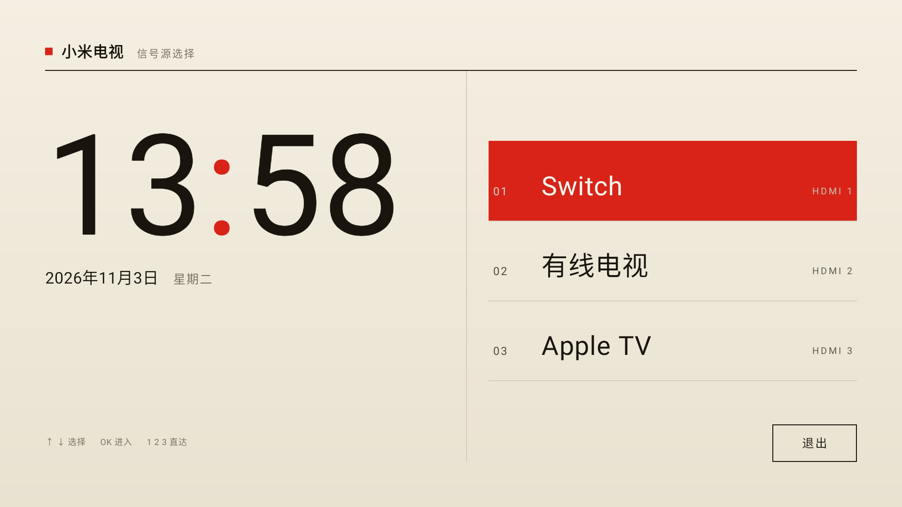
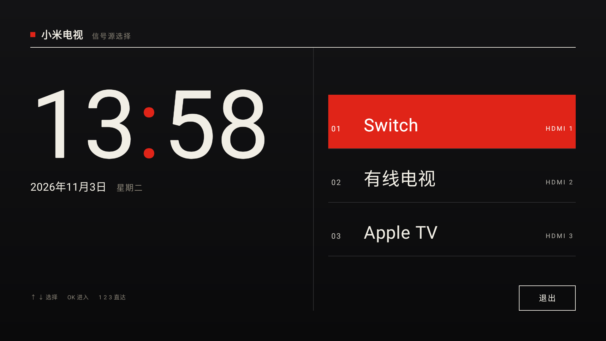

# 归藏 · 瑞士桌面（GuiZang Swiss Home）

给小米电视做的极简瑞士风格桌面：**只有三个 HDMI 入口和一个退出按钮**。白天米色、日落后深色，
开机默认进入，遥控器上下选择、确认即切信号源。

[中文说明](#中文说明) · [English](#english)




> 基于 [op7418/guizang-tv](https://github.com/op7418/guizang-tv)（MIT）整理的分支版本。
> 原项目的列表 / Dock / 磁贴 / 壁纸 / 设置界面仍保留在 APK 内，但不再作为默认入口。
> 上游再往前的来源是 [Gathin23/cleanyourtv](https://github.com/Gathin23/cleanyourtv)（MIT）。

## 这是什么

- **三个信号源**：HDMI 1 / 2 / 3，直接调用小米的 `ExternalSourceActivity` 切换，失败自动回退系统信号源面板。
  实测 `input=23/24/25` 分别对应 HDMI 1/2/3。
- **一个退出**：右下角小按钮，回到小米原桌面（公开入口 `com.mitv.tvhome/.MainActivity`）。
- **瑞士风格**：Helvetica 式无衬线、栅格、细分隔线、瑞士红 `#D92318`；1920×1080 设计稿等比适配 4K。
- **日夜自动**：用 NOAA 太阳方程在本地算日出日落，白天米色、夜间深色，每分钟检查一次。
  默认坐标是上海市中心，改 `SwissSun.LATITUDE / LONGITUDE` 即可换城市。
- **开机默认进入**：借助一个轻量无障碍服务接管小米桌面（原因见下）。
- 不联网、无广告、无壁纸素材；APK 约 2 MB，不带 AndroidX。

## 界面与操作

| 操作 | 行为 |
| --- | --- |
| 上 / 下 | 在 01 / 02 / 03 三个信号源之间移动，第三个再往下进入「退出」 |
| 确认 | 切换信号源；在「退出」上回到小米桌面 |
| 左 | 从「退出」回到第三个信号源 |
| 数字 1 / 2 / 3 | 直接切换 HDMI 1 / 2 / 3 |
| 返回 | 无动作（桌面不退出） |

焦点行整行填充瑞士红、文字反白，填充从左向右扫过；进入桌面时顶部细线、时钟、三行信号源依次淡入。

## 开机默认进入与 Home 键

这台小米固件把桌面锁得很死，实测结论：

1. 声明 `android.intent.category.HOME` 后，在 Android 原生「默认主屏幕应用」里可以选中本应用，
   `cmd package set-home-activity` 也能让 RoleManager 的 HOME holder 变成它；
2. 但小米改过的 `RootWindowContainer.resolveHomeActivity()` 忽略这个角色，Home 键最终启动的仍是
   `com.mitv.tvhome/.MainActivityUserMode`；桌面组件受保护，`pm disable-user` 会抛 `SecurityException`；
3. 完整重启会把 `/data` 下的第三方应用置为 stopped，`BOOT_COMPLETED` 不会投递给它们。

所以本项目用一个**只读窗口包名和类名**的无障碍服务（`SwissAccessibilityService`，
`canRetrieveWindowContent=false`，不读屏幕内容）在小米桌面出现时把瑞士桌面拉回前台，
并在开机后服务刚绑定的几秒内补两次拉升。启用命令：

```sh
adb shell settings put secure enabled_accessibility_services \
  "com.xiaomi.voicecontrol/com.xiaomi.voicecontrol.VoiceAccessibilityService:io.github.op7418.guizangtv/io.github.op7418.guizangtv.SwissAccessibilityService"
adb shell settings put secure accessibility_enabled 1
```

> 请保留原有的服务列表，只追加我们这一项；不同固件的列表可能不同，先读一遍再写。

已知限制：

- 从其他应用按 Home 时，小米桌面会先闪约 0.3–0.5 秒，再切到瑞士桌面；
- 已经停在小米桌面时再按 Home 不会跳回（没有新的窗口状态事件），从小米桌面打开任意应用再按 Home 即可回来；
- 应用更新后无障碍绑定可能被系统清掉，重新执行上面的两条命令即可；
- 只在一台小米电视 S Pro 65 2025（`MiTV-MFFU0`，HyperOS 2.0.8.0.UFFMATV / Android 14）上验证，
  其他固件的桌面组件名、窗口类名可能不同。

## 安装

从 [Releases](https://github.com/Baizhi-Angelica/guizang-swiss/releases) 下载 APK（或自行构建），然后：

```sh
adb connect <电视IP>:5555
adb install -r guizang-swiss-v0.5.0.apk
adb shell am start -n io.github.op7418.guizangtv/.SwissHomeActivity
```

首次连接需要在电视上确认调试授权。之后按上面的命令启用无障碍服务并重启电视验证。
更完整的配置、广告清理、回滚步骤见 [docs/SWISS-HOME.md](docs/SWISS-HOME.md)。

## 构建

要求：JDK 17、Android SDK Platform 34、Build Tools 34.0.0、Gradle 8.9。工程没有第三方运行时依赖（只有 JUnit 做单元测试），
也不含 Gradle Wrapper。

```sh
gradle :app:assembleDebug :app:testDebugUnitTest
# 产物 app/build/outputs/apk/debug/app-debug.apk
```

> 工程路径含非 ASCII 字符时 AGP 可能报路径检查失败；仓库已附 `android.overridePathCheck=true`，
> 更稳妥的方式是在纯 ASCII 路径下构建。

## 保留的小米功能与广告清理

- `tvapp_one_touch_play`（一触即播）、`mitv.settings.db.video.auto_switch`、CEC 设置均未改动；
  `boot_auto_play`（开机直接播放信号源）如开启会优先于本桌面，按需在电视设置里关闭。
- 可选的广告清理（全部可逆）：禁用电视商城 / 商城插件 / 推送广告服务，推荐位设为 0。
  小米桌面首页的内容位无法在不 root 的情况下移除。详见文档。

## 文档

- [瑞士桌面完整说明](docs/SWISS-HOME.md)：开机 / Home 原理、日夜、广告清理、回滚
- [兼容性记录](docs/COMPATIBILITY.md)
- [本次变更记录](docs/changes/2026-11-03-swiss-home.md)
- 上游项目文档仍保留在 `docs/`（设置、壁纸、开机、Codex 实验等）

## 许可

代码以 [MIT](LICENSE) 发布，版权声明沿用上游：Copyright (c) 2026 Gathin、guizang-tv contributors。
本项目对瑞士桌面的修改同样以 MIT 发布。第三方素材、商标与数据来源见 [NOTICE.md](NOTICE.md)。
不隶属于小米、Sony、Apple 或哔哩哔哩。

---

# English

A Swiss-style minimal Android TV home for **Xiaomi TVs**: three HDMI sources and a small exit target. Warm paper by day,
deep night after sunset, boot straight into it, and a strict typographic grid instead of the stock launcher.

Built on top of [op7418/guizang-tv](https://github.com/op7418/guizang-tv) (MIT), which itself derives from
[Gathin23/cleanyourtv](https://github.com/Gathin23/cleanyourtv) (MIT). The original list / dock / tile / wallpaper /
settings screens are still in the APK but no longer the default entry.

## Features

- **Three HDMI rows** (`01 Switch`, `02 有线电视`, `03 Apple TV`) that launch Xiaomi's
  `com.xiaomi.mitv.tvplayer/.ExternalSourceActivity` with `input=23/24/25`, falling back to the system input panel.
- **One exit target** back to the stock Xiaomi home via `com.mitv.tvhome/.MainActivity`.
- **Sun-driven palette**: sunrise/sunset computed locally (NOAA equations, Shanghai coordinates by default),
  paper during the day and dark after sunset, rechecked every minute.
- **Boot takeover**: Xiaomi's framework ignores the Android HOME role and protects its launcher component, so a small
  accessibility service (`canRetrieveWindowContent=false`, window package/class names only) brings this home back to the
  front. See [docs/SWISS-HOME.md](docs/SWISS-HOME.md) for exact behavior and limitations.
- Remote: up/down between sources and exit, OK to open, number keys 1–3 for direct HDMI switching.

## Install

Download the APK from [Releases](https://github.com/Baizhi-Angelica/guizang-swiss/releases), then:

```sh
adb connect <TV_IP>:5555
adb install -r guizang-swiss-v0.5.0.apk
adb shell am start -n io.github.op7418.guizangtv/.SwissHomeActivity
```

Enable the accessibility service as described in the Chinese section to get boot/Home behavior.

## Build

JDK 17, Android SDK Platform 34, Build Tools 34.0.0, Gradle 8.9. No third-party runtime dependencies.

```sh
gradle :app:assembleDebug :app:testDebugUnitTest
```

## License

MIT, with the upstream copyright notice retained (see [LICENSE](LICENSE) and [NOTICE.md](NOTICE.md)).
Tested on a Xiaomi TV S Pro 65 2025 (`MiTV-MFFU0`, HyperOS 2.0.8.0, Android 14) only.
